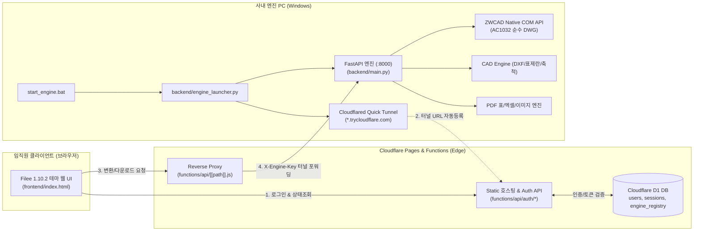

# CONCOST Total Studio 인수인계서 (Handover Document)

> **프로젝트**: CONCOST Total Studio (사내 CAD/도면/문서 변환 토탈웹)  
> **기준 커밋**: `b4af898` (fix: block stale /employees.json edge cache)  
> **배포 URL**: https://concost-total-converter.pages.dev  
> **저장소 경로**: `e:\■ 개발_TF팀\변환 토탈웹`  
> **인수인계 대상**: 안티그래비 데스크톱 앱(Antigravity Desktop) 및 후속 개발자

---

## 1. 시스템 핵심 아키텍처



### 핵심 작동 메커니즘
1. **서버리스 제약 극복 (하이브리드 구조)**:
   - Cloudflare 서버리스 환경에서는 C++ 바이너리(PyMuPDF, shapely, ezdxf) 및 Windows 전용 ZWCAD COM API 실행 불가.
   - 프론트엔드와 사내 임직원 인증은 **Cloudflare Pages + D1**에서 처리.
   - 실제 고난도 변환(DWG/DXF/PDF)은 **사내 PC의 FastAPI**가 처리하며, **Cloudflare Quick Tunnel**을 통해 고정 IP나 유료 도메인 없이 안전하게 Edge와 연결.
2. **동적 엔진 레지스트리**:
   - `start_engine.bat` 실행 시 매번 임의 발급되는 `https://*.trycloudflare.com` URL을 파싱하여 Cloudflare D1 `engine_registry`에 자동 업데이트.
   - Pages 프록시(`functions/api/[[path]].js`)가 최신 터널 URL로 실시간 포워딩.

---

## 2. 프로젝트 디렉터리 구조 및 모듈 역할

```text
변환 토탈웹/
├── .engine.env                        # 사내 엔진 인증 키 (ENGINE_KEY)
├── start_engine.bat                  # [핵심] 사내 변환 엔진 + 터널 원클릭 구동기
├── start_server.bat                  # 로컬 단독 테스트용 구동기 (포트 8000)
├── wrangler.jsonc                    # Cloudflare Pages & D1 바인딩 설정
├── requirements.txt                  # Python 3.11+ 의존성 패키지
├── schema.sql                        # D1 초기 117명 임직원 데이터 및 스키마
├── CONNECT_TALK_직원계정.xlsx        # 원본 임직원 명단 (22개 시트)
│
├── backend/                          # 사내 PC 변환 백엔드
│   ├── engine_launcher.py            # Uvicorn + Cloudflared 프로세스 관리 및 D1 등록 런처
│   ├── main.py                       # FastAPI REST API 엔드포인트 (/api/convert, /cad/* 등)
│   ├── auth.py                       # 로컬 단독 실행용 임직원 인증 모듈 (SHA-256)
│   ├── generate_d1_schema.py         # 엑셀 파싱 -> D1 SQL 스키마 생성기
│   ├── engines/                      # 6대 카테고리 변환 엔진
│   │   ├── cad/
│   │   │   ├── cad_engine.py         # CAD 통합 인터페이스
│   │   │   ├── concost_converter.py  # PDF -> DXF (3차 베지어 적응 분할, 건축 레이어 분리)
│   │   │   ├── concost_dwg.py        # ZWCAD COM API 연동 순수 바이너리 DWG 생성
│   │   │   ├── scale_detection.py    # 표제란 축척(1:100 등) 자동 감지
│   │   │   └── zwcad_save.ps1        # ZWCAD 백그라운드 COM PowerShell 스크립트
│   │   ├── document/
│   │   │   ├── table_engine.py       # PDF 표/내역서 -> XLSX 격자 복원
│   │   │   └── document_engine.py   # PDF <-> TXT 텍스트 추출/합성
│   │   ├── general/
│   │   │   └── image_engine.py       # 이미지 포맷 변환 및 300DPI 렌더링
│   │   └── archive/
│   │       └── archive_engine.py     # 다중 파일 ZIP 압축
│   └── tests/
│       ├── live_e2e_check.py         # [핵심] Pages 라이브 배포 E2E 전수 검증
│       ├── verify_all_categories.py  # 6대 엔진 로컬 무결성 검증
│       └── verify_cad_category.py    # CAD DXF/DWG 전용 검증
│
├── frontend/                         # 정적 웹 애플리케이션 (Filee UI)
│   ├── index.html                    # 3단계 파이프라인 (BEFORE-TRANSFORM-AFTER)
│   ├── style.css                     # 네이비 글래스모피즘 & 원형 휠 스타일링
│   └── app.js                        # 세션 관리, API 호출, 변환 상태 머신
│
└── functions/                        # Cloudflare Pages Functions (Edge API)
    ├── _shared.js                    # D1 세션 토큰 검증 유틸
    ├── employees.json.js             # 임직원 목록 (Edge 캐시 방지 적용)
    └── api/
        ├── [[path]].js               # 사내 PC 터널로 리버스 프록시 (엔진 토큰 부착)
        ├── auth/
        │   ├── login.js              # D1 기반 SHA-256 로그인 및 토큰 발급
        │   ├── employees.js          # D1 임직원 목록 조회
        │   └── change-password.js    # D1 임직원 비밀번호 변경
        └── engine/
            └── register.js           # 사내 PC 터널 URL 등록 엔드포인트
```

---

## 3. 핵심 환경변수 및 인증 체계

| 대상 | 키 이름 | 위치 | 설명 |
| :--- | :--- | :--- | :--- |
| **사내 PC** | `ENGINE_KEY` | `.engine.env` | 터널 통신 보안용 사전 공유 키 (PSK) |
| **Cloudflare Pages** | `ENGINE_KEY` | Pages Secret | 사내 PC가 터널 주소 등록 시 검증 및 프록시 헤더 부착용 |
| **Cloudflare D1** | `DB` | `wrangler.jsonc` | DB 바인딩 이름 (`concost-total-converter-d1`) |
| **임직원 계정** | 초기 PW: `1234` | D1 `users` 테이블 | SHA-256 단방향 해시 저장 (`salt` 없음, 단순 해시) |

---

## 4. 구동 및 운영 절차

### 1) 사내 변환 엔진 기동 (업무 시작 시)
- 바탕화면 또는 프로젝트 루트의 **`start_engine.bat`** 더블 클릭 실행.
- 수행 작업:
  1. `.engine.env`에서 `ENGINE_KEY` 로드
  2. 로컬 FastAPI (포트 8000) 기동 및 `/api/health` 헬스체크
  3. `cloudflared` Quick Tunnel 기동
  4. 생성된 임시 URL(`https://*.trycloudflare.com`)을 Cloudflare Pages의 `/api/engine/register`로 전송하여 D1에 갱신
- **주의**: 이 창을 닫으면 외부 임직원의 변환 요청이 `502/503` 에러를 반환합니다.

### 2) 클라우드플레어 재배포 (코드 수정 시)
```bash
# Cloudflare Pages 수동 배포
npx wrangler pages deploy . --project-name concost-total-converter

# D1 마이그레이션 적용 시
npx wrangler d1 migrations apply concost-total-converter-d1 --remote
```

### 3) 무결성 및 라이브 상태 검증
```bash
# 1. 사내 로컬 엔진 6대 전 카테고리 검증 (1초 소요)
python backend/tests/verify_all_categories.py

# 2. 라이브 Pages 실제 배포 환경 E2E 검증 (로그인, 프록시, PDF->DXF 실변환)
python backend/tests/live_e2e_check.py
```

---

## 5. 안티그래비 데스크톱 앱 전환 시 즉시 고려할 사항 (To-Do & Tips)

### A. 안티그래비 데스크톱 앱(Tauri / Electron / PySide) 통합 권장 구조
1. **임베디드 엔진 모드**:
   - 데스크톱 앱 내에서 `backend/engine_launcher.py` 로직을 백그라운드 프로세스로 자체 내장.
   - 사외 접속용 Cloudflare Tunnel 등록 모드와 사내 로컬 단독 모드(`127.0.0.1:8000`)를 토글 버튼으로 제공.
2. **트레이 최소화 (System Tray)**:
   - 변환 콘솔 창이 열려 있어야 하는 불편함을 없애기 위해 윈도우 시스템 트레이 아이콘으로 백그라운드 상주 처리.

### B. ZWCAD / AutoCAD 연동 고도화
- 현재 `backend/engines/cad/concost_dwg.py`는 `ZWCAD.Application` COM 개체를 통해 바이너리 `AC1032(DWG 2018)`를 저장합니다.
- 만약 사내 PC에 ZWCAD가 없을 경우 오픈소스 대안(LibreCAD / ODA File Converter CLI)으로 자동 폴백(Fallback)하도록 브랜칭 추가 고려 필요.

### C. 파일 가비지 컬렉션 (GC)
- `storage/uploads/` 및 `storage/outputs/` 디렉터리에 변환 파일이 누적됩니다.
- 24시간 이상 지난 임시 파일을 자동 정리하는 Background Task(또는 크론잡) 등록 권장.
